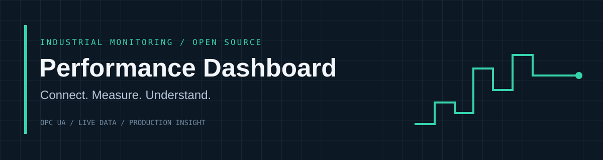

# Performance Dashboard



[](https://github.com/Sparkz400/performance_dashboard/actions/workflows/ci.yml)
[](https://github.com/Sparkz400/performance_dashboard/actions/workflows/security.yml)
[](LICENSE)

An industrial monitoring dashboard for exploring machine data, production trends,
alarms and overall equipment effectiveness (OEE). Connect OPC UA machines, map
their signals, and build a shared view of a production line.

> **Status:** development software for evaluation with owned simulators and test
> equipment. Local and automated tests do not establish production reliability,
> machine compatibility, regulatory compliance or safety-system suitability.
> See [status and limitations](docs/STATUS.md). This is an independent project.

[Getting started](docs/GETTING_STARTED.md) · [Architecture](docs/ARCHITECTURE.md) ·
[Compatibility](docs/COMPATIBILITY.md) · [Roadmap](docs/ROADMAP.md) ·
[TODO](TODO.md) · [Research](docs/RESEARCH.md) · [Contributing](CONTRIBUTING.md) ·
[Discussions](https://github.com/Sparkz400/performance_dashboard/discussions)

## What it does

- Browse OPC UA nodes and configure per-machine tag mappings.
- Connect with protected machine identities, explicit certificate trust and redacted commissioning diagnostics.
- Display live readings and historical charts in configurable dashboards.
- Calculate OEE from explicitly mapped machine states and production counters.
- Preserve scalar values, source timestamps and quality information in history.
- Retain namespace-aware signal identity and receive time for new measurements.
- Show bounded trends over the full selected interval with quality gaps and resolution.
- Buffer measurements on local disk and replay them after database interruptions.
- Commission namespace-aware machine profiles and create a machine dashboard.
- Track running/idle/fault/unknown intervals, classify stops and reconcile a shift report.
- Persist alarm transitions and signed webhook retries with authenticated acknowledgment.
- Enforce admin/viewer access and disconnect revoked or expired sessions.

Additional experimental screens include statistical process control, digital
twins, recipes and compliance records. Their presence is not a support or
certification claim; see [current status](docs/STATUS.md).

The interface uses locally bundled Figtree fonts, including charts and wallboards,
with tabular numerals for stable measurements and monospace technical identifiers.
Fonts require no internet access; see [font source and license](client/public/fonts/figtree/README.md).

Light and dark modes share a restrained industrial theme: grey/charcoal surfaces,
raised controls, recessed charts and orange accents. Status indicators retain
their distinct colors and labels. Keyboard focus and reduced-motion preferences
are supported; the style does not change measurement or quality semantics.

Edge synchronization is disabled until canonical central ingestion is implemented.
The AI assistant and external AI-provider integration have been removed.
Public links/embeds and legacy alarm email/chat/SMS channels are disabled.
See the [production workflow](docs/PRODUCTION_WORKFLOW.md) and
[P0 acceptance evidence](docs/P0_ACCEPTANCE.md) for tested paths and remaining gates.
The first nominated pilot family is [Siemens SIMATIC S7-1500](docs/S7_1500_PILOT.md);
software acceptance uses owned simulators, with physical CPU qualification still open.
For isolated installation, complete backups, restore checks and upgrades, see the
[operations guide](docs/OPERATIONS.md).
The [operator workflow](docs/OPERATOR_WORKFLOW.md) covers handover actions, reviewed
manual counts and the supervisor wallboard with a dedicated read-only account.
[Unattended operation](docs/UNATTENDED_OPERATION.md) covers durable scheduled reports,
email retry status, alarm holds/hysteresis and collector/data-health incidents.
The [legacy gateway recipe](docs/LEGACY_GATEWAY.md) includes a read-only Modbus TCP
adapter, owned simulator and reusable production profile.
[Incident replay](docs/INCIDENT_REPLAY.md) joins bounded historical signals, alarm
transitions, operator revisions and stop classifications with explicit clock and gap information.
See [factory-pilot acceptance](docs/FACTORY_PILOT_ACCEPTANCE.md) for tested software
milestones and the separate physical-machine gates.

The [daily operations guide](docs/DAILY_OPERATIONS.md) covers machine/site access,
recurring shift calendars, product runs and frozen reports, maintenance inspections,
metered energy and reviewed history retention. Core workflows support English/German.
See [daily workflow acceptance](docs/DAILY_OPERATIONS_ACCEPTANCE.md) for software evidence.

[Quality and line operations](docs/QUALITY_LINE_OPERATIONS.md) adds frozen batch
recipes, inspections/rework/lot traceability, reviewed SPC reference baselines,
line-loss investigations and linked alarm maintenance actions. It also documents
measured disk runway, reviewed retention scheduling, offline image packages and
configurable multi-day synthetic workloads. Advanced screens currently require
an administrator; multi-day reliability and supported capacity remain unqualified.

## Where it is going

The [roadmap](docs/ROADMAP.md) starts with trustworthy measurements and a useful
one-line pilot, then develops connectivity, production workflows, quality,
maintenance, energy and multi-site operation. The [research assessment](docs/RESEARCH.md)
separates current code from proposed capabilities; the [TODO backlog](TODO.md)
tracks priorities, dependencies and completion criteria. These are plans, not
released features or compatibility promises.

## Quick start

Install **Node.js 24**, npm and **Docker Desktop** (or Docker Engine with Compose).
Run commands from the repository root. No physical machine is needed for the demo.

```sh
npm ci
npm run build:server
docker compose -f compose.local.yml up -d --wait db
```

Copy `server/.env.example` to `server/.env`. Set unique `COOKIE_SECRET`,
`SESSION_SECRET` and `SEED_ADMIN_PASSWORD` values; the admin password must contain
at least 12 characters. Keep this file private.

```sh
npm run db:migrate -w server
npm run db:seed -w server
npm start
```

In another terminal, run `npm run simulate`. Open **http://localhost:5173** and
sign in as `admin` with your `SEED_ADMIN_PASSWORD`. The local API uses port **3001**,
the simulator **4841**, and the isolated PostgreSQL database **55432**.

On Windows, after configuring `.env`, `./scripts/start-local.ps1` starts the
database, simulator, server and browser development server in the background.
Use `./scripts/start-local.ps1 -Stop` to stop its Node processes. Logs are in
`.local/`; the database and measurement spool are preserved.

Follow [Getting started](docs/GETTING_STARTED.md) to activate the simulator,
map signals and create a dashboard, or run the container deployment.

## Development checks

```sh
npm run build
npm run lint
npm run format:check -w client
npm run test:coverage
npm run test:e2e
```

Browser tests need the local database, seeded credentials and Chromium. See
[Contributing](CONTRIBUTING.md) for the full commands and CI boundaries.
Security checks include the full npm audit, CodeQL and exact-image container reports.
The production image uses Node 24/Wolfi and browser-free PDFs; the full migrated
image scan is clear. See the [dependency and image review](docs/DEPENDENCY_REVIEW.md)
and [reporting compatibility/upgrade guide](docs/REPORTING.md) for evidence and limits.

## License

Apache-2.0; see [LICENSE](LICENSE) and [NOTICE](NOTICE). Dependencies retain their
own licenses. OPC UA and vendor names belong to their respective owners.
