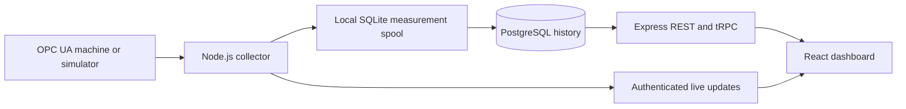

# Architecture

This page describes the current system. See the [roadmap](ROADMAP.md#technical-direction)
for proposed contracts and the [research assessment](RESEARCH.md) for implementation gaps.

`client/` contains the browser application. `server/` contains authentication,
machine connections, business services, persistence and reports. `shared/`
contains API and socket contracts. Compile shared types before dependent builds.

The client bundles Figtree variable fonts locally (regular and italic, UI weights
400–700). The shared CSS font family also feeds the component and chart themes;
tabular numerals keep changing measurements aligned, while technical identifiers
retain monospace. The service worker precaches the font stylesheet and both font
files. No external font service is needed; provenance and license are in
[the font directory](../client/public/fonts/figtree/README.md).

`client/src/theme/modernTheme.ts` defines both industrial palettes and component
surfaces. Orange marks primary actions and focus; neutral secondary controls and
semantic status colors remain distinct. `chartTheme.ts` shares readable axes,
legends and tooltips across chart views. Theme selection, system appearance and
reduced-motion preferences apply without changing measurement processing.

The collector stores each scalar sample in a synchronous, durable local SQLite
queue before broadcasting it. PostgreSQL receives a stable event ID, server and
source timestamps, raw scalar value, quality and numeric projection. Good Boolean
values project to 0/1; text and bad-quality values remain available as raw values
but do not become chart numbers. The event/timestamp constraint prevents duplicate
replay after an ambiguous commit. Failed writes stay in the local spool. A record
PostgreSQL refuses with a data or integrity error moves to a quarantine table in the
same spool file so later samples are not blocked; administrators export or requeue it.

New samples also retain receive time and signal metadata: endpoint, machine,
namespace URI, identifier, mapping revision and optional engineering unit.
Identity uses namespace URI rather than the transient namespace index. Migration
0003 adds nullable columns; legacy rows remain unknown. Units are read when the
server exposes EngineeringUnits, otherwise null. Historical queries still select
machine/tag aliases; review remapping before combining different physical signals.

Trend queries require a machine and aggregate dense windows across the requested
interval, with a 2,000-point bound, sample counts, resolution and unknown/bad gaps.
Observations do not establish continuity. SPC windows are keyed by profile,
machine and tag; baseline/chart queries use the same machine boundary.

The old edge receiver did not populate canonical history. Edge mutations now
fail with 501 and the queue is preserved for a future explicit migration.
The AI assistant and its external-provider integration have been removed.

The spool is for one collector process on a durable local filesystem. A PostgreSQL
session advisory lock held on a dedicated connection keeps a second collector against
the same database from acquiring. Preserve `server/data/` or the container volume. Disk exhaustion and abrupt hardware loss
are operational limits; monitor storage. This is not a replicated historian.

OEE reads the last sample at or before the window start, then subsequent changes.
State durations are clipped to the requested window. Missing and unmapped states
remain unknown. Production counters sum increments; a decrease is interpreted as
a reset to zero. Modulus rollover and unobserved resets need machine-specific
qualification. Incomplete coverage is flagged and the OEE gauge avoids presenting
a confident percentage.

Deployment uses one application per organization. Current global access roles
and plant tables do not provide verified isolation between independent tenants.

## Production workflow

The durable worker now evaluates alarms after history insertion and before spool
acknowledgment. Incident transitions, event receipts and pending webhook delivery
rows commit together; receivers deduplicate delivery IDs. That outbox table carries a
schema version, retries with backoff and stops at a dead letter that administrators
requeue ([integration contract](INTEGRATION_API.md)). Profiles and shift inputs
are immutable snapshots; operator corrections append history. Authorization checks
the current account at REST/tRPC boundaries and socket actions, with logout/expiry
disconnection. Unauthenticated access is limited to expiring, revocable links to
selected trend widgets ([security boundaries](SECURITY_BOUNDARIES.md#selected-data-links-f08)).
See [contracts and limits](PRODUCTION_WORKFLOW.md).

Scheduled trend/alarm/OEE reports are text/vector PDFs generated by PDFKit with
embedded fonts. The Node 24/Wolfi production image has no browser; browser automation
remains in development tests. PostgreSQL schema, durable spool/report volume paths
and user 1000 are unchanged. See [reporting contracts and migration](REPORTING.md).

## Daily workflow boundaries

An asynchronous request scope carries current machine/dashboard grants through REST
and individual tRPC calls; socket rooms and streamed exports use the same account
boundary. Background jobs retain explicit administrator scope. Additive migrations
store calendar plans, product runs, immutable report snapshots, inspection history,
energy meters/reconciliation and reviewed retention previews. Retention summarizes
and removes a bounded batch atomically while protecting production/service evidence.
See [daily operations](DAILY_OPERATIONS.md) for contracts and upgrade behavior.

## Quality and line evidence

Batch recipes and SPC reference readings are frozen in PostgreSQL. Inspections,
rework verification, declared lot links, line definitions and maintenance actions
use attributable, validated records. The health worker advances reviewed retention
jobs and durable escalation; notification suppression defers existing outbox rows.
See [quality and line contracts](QUALITY_LINE_OPERATIONS.md) for boundaries and
[the migration](../server/drizzle/0015_quality_evidence.sql) for storage changes.
