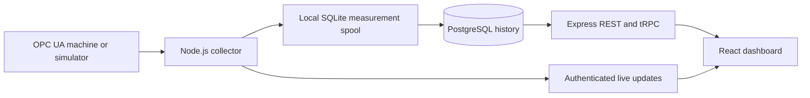

# Architecture

`client/` contains the browser application. `server/` contains authentication,
machine connections, business services, persistence and reports. `shared/`
contains API and socket contracts. Compile shared types before dependent builds.

The collector stores each scalar sample in a synchronous, durable local SQLite
queue before broadcasting it. PostgreSQL receives a stable event ID, server and
source timestamps, raw scalar value, quality and numeric projection. Good Boolean
values project to 0/1; text and bad-quality values remain available as raw values
but do not become chart numbers. The event/timestamp constraint prevents duplicate
replay after an ambiguous commit. Failed writes stay in the local spool.

The spool is for one collector process on a durable local filesystem. Preserve
`server/data/` or the container volume. Disk exhaustion and abrupt hardware loss
are operational limits; monitor storage. This is not a replicated historian.

OEE reads the last sample at or before the window start, then subsequent changes.
State durations are clipped to the requested window. Missing and unmapped states
remain unknown. Production counters sum increments; a decrease is interpreted as
a reset to zero. Modulus rollover and unobserved resets need machine-specific
qualification. Incomplete coverage is flagged and the OEE gauge avoids presenting
a confident percentage.

Deployment uses one application per organization. Current global access roles
and plant tables do not provide verified isolation between independent tenants.
