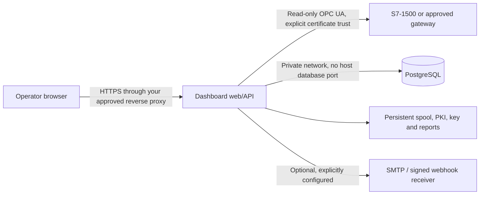

# Install, back up, restore and upgrade

For configuration-only transfer and signed, versioned offline release candidates,
see [factory operations](FACTORY_OPERATIONS.md). Verify release signatures with an
independently trusted public key before using the offline installer.

Use Node.js 24, Docker Compose and an image that passed CI and an exact-image
security scan. The commands below manage a single-company installation with one
collector, PostgreSQL 16 and named volumes. Run them from the repository root.
Use a unique project name. Existing projects and backup destinations are never
overwritten by installation/restore.



Keep the acquisition interface in the approved OT network. Permit only configured
OPC UA endpoints and approved outbound receivers; no internet route to a PLC is
required. PostgreSQL is not published to the host. The app connects as `dashboard`,
a non-superuser role that owns only its database; a separate `postgres` superuser
exists for maintenance. Installations created before 2026-10-29 keep their original
roles until restored into a fresh project. The app runs as UID 1000; use
separate installations for separate companies. Metrics and support diagnostics
require an authenticated administrator. TLS termination, firewall rules and the
PLC user's read-only rights still require verification at the actual installation.

## Install and review

```text
node scripts/operate.mjs install --project factory-pilot --image performance-dashboard:factory-pilot --directory .local/factory-pilot --port 3002
```

The installer generates unique database/session secrets and an initial admin
password in the private `initial-login.json` file under the destination directory.
The generated `compose.json` is the installation's authoritative configuration.
Protect both files with host access controls; on Windows apply appropriate ACLs.
Do not commit, publish or attach these files to issues.

The first start is an **isolated recovery preview**. Its browser is available on
the chosen loopback port through a small proxy; the app and database remain on an
internal network. Automatic connections, spool processing, schedules and webhook
deliveries are paused. REST/tRPC changes are refused. Login/logout remain available
so an administrator can inspect the restored data. The UI shows a recovery banner.

After reviewing the configuration, access policy and intended machine endpoints:

```text
node scripts/operate.mjs activate --project factory-pilot --file .local/factory-pilot/compose.json
```

Activation removes the preview proxy, enables normal networking and restarts the
installation without deleting volumes. Configured jobs and connections may begin.
Keep only one active collector; a second app process on the same database waits for the
collector lease and takes over when the holder dies ([high availability](HIGH_AVAILABILITY.md)). Set up HTTPS and the correct `CLIENT_URL` before
exposing the service beyond the workstation; the installer binds only to loopback.
For the first PLC, follow the [S7-1500 guide](S7_1500_PILOT.md).

## Complete backup

```text
node scripts/operate.mjs backup --project factory-pilot --file .local/factory-pilot/compose.json --output .local/backups/pilot-before-upgrade
node scripts/operate.mjs verify --project factory-pilot --backup .local/backups/pilot-before-upgrade
```

Backup briefly stops the app, waits for shutdown, takes a PostgreSQL custom-format
dump and copies the complete measurement, certificate and report volumes. It
also saves the exact application/database images and effective private runtime
configuration. A manifest checks every file with SHA-256. The app resumes if it
was running, including after a failed backup. An incomplete directory without a
valid manifest is not a recovery point.

The stopped application makes the database and file snapshot consistent for this
single-writer installation. External writers and extra collectors are outside this
contract. The encrypted machine credentials and their key are both included;
losing either prevents credential recovery. A checksum detects changes, but does
not authenticate an untrusted backup. Use trusted storage and encrypt off-site
copies with your organization's backup system.

The tool checks standard paths under `/app/server/data`, `certificates` and
`reports`. Existing installations with a different PKI location must first preserve
and move their actual certificate/key files into the persistent certificate volume
and set `OPCUA_PKI_DIR`. Do not regenerate an existing identity to make backup pass.
The configuration-only export in Settings is not a full recovery backup.

## Restore test and rollback

```text
node scripts/operate.mjs restore --project factory-restore --backup .local/backups/pilot-before-upgrade --directory .local/factory-restore --port 3003
```

Restore checks every file before loading the saved images. It creates fresh named
volumes, restores PostgreSQL, copies all persisted files with the application owner,
runs migrations and waits for health checks. It always starts in isolated preview.
Existing projects are refused, even if stopped. Review machine identities, pending
measurements, report downloads and login before activation. A backup verification
alone does not prove a working restore.

Restores cancel retention deletions that were scheduled or part-way through when the
backup was taken, so restoring to recover history cannot silently delete it again.
Raw samples removed after the backup return with the restore, and no hourly summary
double-counts them. Review a new retention preview after activation if still wanted.

Use the same restore command for rollback after a failed upgrade. The saved image
and pre-upgrade database travel together; do not run old code against a migrated
database or attempt an automatic down-migration. Preserve the failed installation
and any measurements accepted after the backup. A rollback returns to that backup's
time boundary; later data needs a separately reviewed recovery, not silent deletion.
Stop the original collector before activating the restored installation.

## Upgrade

Build/pull and validate the new image first. The image must already exist locally.

```text
node scripts/operate.mjs upgrade --project factory-pilot --file .local/factory-pilot/compose.json --image performance-dashboard:validated-next --output .local/backups/pilot-upgrade-checkpoint
```

Upgrade takes a complete verified backup while holding the app stopped, changes
the image and waits for migration/startup/database health. A failed upgrade leaves
the app stopped and its volumes intact. Restore the checkpoint into a fresh project
to investigate or roll back. A healthy process does not qualify PLC operation;
check freshness, queued measurements and reports after a supervised upgrade.

For a rehearsal, restore a backup with `--image` set to the candidate image. This
tests its migrations in isolated preview without changing the original installation.

For several edge sites, stage the version centrally, upgrade one edge, confirm its link
status and the central site overview, then continue. To stop, clear the staged version;
to roll back an edge, restore its checkpoint with the previous image
([edge sites](MULTI_SITE.md#lifecycle-e04)).

## Diagnostics and acceptance

`/healthz` returns readiness and normal/recovery mode without credentials or
infrastructure details. Readiness requires a working database. Authenticated
Settings and Production diagnostics provide collector, queue and connection state.
Certificate expiry, identity failures and stale values require separate review.
Production's **Download support diagnostics** contains only the latest 200 machine,
report and delivery status rows, with a three-second limit per database statement.
It excludes names, endpoints, values, private paths, logs, recipients and credentials.
Collector details include pending count, oldest receive time and storage reserve;
missing receive times remain unknown. It is a support snapshot, not a full audit.

`/metrics` (administrators only) adds operational gauges, read at each scrape:

| Gauge | Meaning |
| --- | --- |
| `opcua_connection_reconnects`, `opcua_connection_losses` (`machine_id`) | Observed since this process started; restarts reset them |
| `measurement_spool_pending`, `measurement_spool_oldest_age_seconds` | Accepted samples waiting for PostgreSQL; age is `NaN` when a receive time is unknown |
| `measurement_last_commit_age_seconds` (`machine_id`) | Time since the last database commit of that machine's samples by this process |
| `database_up`, `database_roundtrip_seconds` | `SELECT 1` within three seconds; round trip is `NaN` when unreachable |
| `background_jobs` (`job`, `state`) | Report generation, report email, undelivered webhooks and retention schedules by state; absent when the database cannot be read |

Alert on growth or age, not single values: a quiet machine also has an old last commit.

`node scripts/test-operations.mjs IMAGE` uses fresh, uniquely named container
projects. It verifies installation, file/database restore, credential decryption,
pending spool and PDF preservation, browser recovery mode, mutation denial,
tampering/overwrite refusal and upgrades. Test containers/volumes are removed;
private local backups and validation evidence remain under `.local/operations-*`
until the task's final cleanup. This is software evidence, not a customer restore
drill or physical-controller acceptance.

Pass an optional second image argument to rehearse an actual earlier-image upgrade:
`node scripts/test-operations.mjs NEW_IMAGE PREVIOUS_IMAGE`. The acceptance receipt
records both. The [factory-pilot evidence](FACTORY_PILOT_ACCEPTANCE.md) includes this
rehearsal with the earlier local candidate and current schema.
