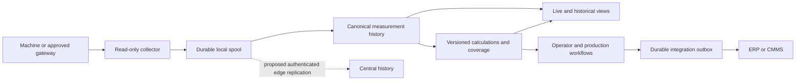

# Product roadmap

Updated **2026-10-26**. Status: **proposed direction and backlog, not a release
commitment**. This roadmap builds on the [capability assessment and research](RESEARCH.md).
The [TODO list](../TODO.md) is the single source of task completion status.

The 2026-10-28 [factory-readiness wave](FACTORY_READINESS.md) focuses on full-stack
endurance, scoped supervisor workflows and fair comparisons of frozen shift
reports. These extend M1–M3 software evidence; they do not close the physical pilot
gate or establish sustained capacity before the long-running workload completes.

## Destination

Make Performance Dashboard a dependable, self-hosted way to understand production
across new and existing industrial machines: connect equipment, see what is
happening, explain losses, and follow improvements over time.

Start with **one company, one line, a few documented machines and a reconciled
shift report**. Broader machine support comes through qualified OPC UA connections,
gateways and selected additional protocols. "Any company" is a long-term market
ambition; it is not a present compatibility or isolation guarantee.

The core product remains read-only toward machines. Operator actions can classify
downtime, record quality, acknowledge dashboard alerts and organize work. Writing
setpoints, starting equipment and PLC program changes require a separate product
decision and machine-specific controls; they are outside this roadmap's delivery scope.

## Who should benefit

| User | Daily question | First useful outcome |
| --- | --- | --- |
| Operator | What needs attention and how do I explain a stop? | Clear machine state, pending downtime reasons, current job and a short handover. |
| Production lead | Where did this shift lose output? | Reconciled OEE, loss Pareto, actual versus target and drill-down to evidence. |
| Automation engineer | Can this machine be connected correctly? | Guided endpoint checks, mapping preview, units/quality, reusable profiles and diagnostics. |
| Maintenance engineer | Which observed conditions need inspection? | Asset timeline, condition thresholds and a linked maintenance record. |
| Quality engineer | Is this process stable and which batches are affected? | Validated SPC, sample context, rejects and batch traceability. |
| IT administrator | Can we operate and recover this safely? | Explicit network boundary, identity controls, backups, upgrades and capacity evidence. |
| Plant manager | Did the change improve performance? | Comparable periods with definitions, coverage and production-mix differences visible. |

These personas and needs are hypotheses to validate in P01. Do not infer an
operator's individual performance from unqualified machine measurements.

## Prioritization

1. Prevent misleading results, data loss and unauthorized exposure.
2. Make commissioning and one complete shift useful to real users.
3. Extend connectivity and storage only against measured pilot needs.
4. Close the loop through operator, quality, maintenance and integration workflows.
5. Scale to sites and advanced analytics once the foundation is demonstrated.

For the early milestones, aim for roughly **60% reliability/correctness and 40%
new user value**. This is a planning guide, not a time estimate. Limit work in
progress to one risky data change and one independent user-facing improvement.
Do not start all workstreams at once.

P0 items block acceptance of the affected capability. They do not require every
experimental module to become production-ready before a small pilot: an explicit
disabled/experimental boundary can satisfy a gating item where its Done criterion
allows that. P1 delivers the first useful workflows; P2 expands a proven use case;
P3 is conditional exploration. Sizes in TODO are relative uncertainty/scope, not
calendar promises. Split large items into reviewable changes before implementation.

## Milestones and exit evidence

There are deliberately no delivery dates without a team, pilot and measured
capacity. Milestones are acceptance gates. Tasks carry a target milestone in TODO;
deferred tasks must be recorded explicitly rather than silently counted as done.

| Milestone | Outcome and principal scope | Exit evidence |
| --- | --- | --- |
| **M0 — Trustworthy evaluation** | Correct trend coverage, isolated SPC or explicit disablement, honest experimental screens, usable alarm path, secure endpoint identity, recovery plan | F01–F10 as applicable; H01–H03, A01, C01–C02, D01–D03, P01. Regression fixtures demonstrate known failure cases; recovery into an isolated installation works; enabled features have clear boundaries. |
| **M1 — One-line pilot** | Guided commissioning, shift calendars, downtime reasons, job/product context, operator view and shift report | M0 gates plus selected C03–C04, O01–O05/O09, U01–U07, A02–A04, R01–R02, D04–D06 and P02/P06. Independent counts and state log reconcile for a complete shift; then a supervised pilot covers normal work and planned interruptions. |
| **M2 — Brownfield connectivity and dependable history** | Needed gateway protocol, stable ingestion contract, retention/rollups, durable events, deterministic reports and tested operational recovery | Required adapters pass C10 fixtures and real endpoint qualification; H04–H07/H09–H10, I01–I05, D07 and relevant alert/report items demonstrate replay, load and operational limits. |
| **M3 — Production improvement workflows** | Better line-loss analysis, validated quality/batches, maintenance, energy and useful asset views | Select a concrete improvement question for O06–O08, Q01–Q07, M01–M06, U08 and X03. Show before/after evidence with comparable conditions and no invented causal claim. |
| **M4 — Multi-site operations** | Authenticated edge ingestion, site permissions, identity federation and fleet administration | H08, D08 and E01–E05 prove authorization boundaries, independent offline operation, deduplication and recovery across a named site pair. Separate companies still use separate installations. |
| **M5 — Evidence-backed intelligence and ecosystem** | Evaluated anomaly detection, selected extensions and demand-led enterprise options | X02/X04/X06, I07–I08 and E06 require separate go/no-go decisions, useful evaluation results and a maintenance owner. No autonomous machine control. |

M1 pilot acceptance is not a general release or machine-family qualification.
M2 and later scopes are selectable: the pilot inventory determines whether MQTT,
Modbus, MTConnect or a gateway recipe creates the most value. A candidate need not
ship every protocol, report and advanced workflow to pass a bounded release gate.

## First execution sequence

Start here, using the detailed Done checks in [TODO](../TODO.md). This is ordering,
not a second checklist.

| Step | Items | Why now |
| --- | --- | --- |
| 1 | P01, F01 | Define the nominated pilot and reproduce the important existing gaps. |
| 2 | H01, H02, H03 | Make signal identity and the displayed time window trustworthy. |
| 3 | F02, F03, F04, F05 | Isolate SPC; prove the alarm path; keep edge limits explicit and remove the AI assistant. |
| 4 | F06, F07, F08, F09, F10 | Qualify spool failure, authorization boundaries, exposure and regression evidence. |
| 5 | C01, C02, D01, D02, D03, A01 | Connect a protected test endpoint, recover the installation and expose a coherent alarm workflow. |
| 6 | C03, C04, U01, U02 | Make correct setup repeatable and understandable. |
| 7 | O01, O02, O03, O04, O05, O09 | Add shift/product context and explainable counts and stops. |
| 8 | U03, U04, U05, U06, U07, A02, A03, A04, R01, R02 | Turn those data into daily operator and supervisor workflows. |
| 9 | D04, D05, D06, P02, P06 | Measure capacity, complete the evidence pack and conduct the nominated pilot. |

Dependencies remain authoritative in TODO. A documentation or UI change may be
done in parallel where it does not depend on an unresolved data contract.

## Workstreams

| Stream | Improve existing | Add new capability | Starting code / backlog |
| --- | --- | --- | --- |
| Foundation | Measurement identity, trend correctness, honest feature boundaries, authorization coverage | Recovery/quality evidence visible to operators | [F](../TODO.md#foundation), [queue](../server/src/queue), [bridge](../server/src/opcuaBridge.ts) |
| Connectivity | Secure OPC UA, namespace-stable mappings, subscription diagnostics | Gateway profiles; demand-led MQTT/Sparkplug, Modbus or MTConnect; companion-model suggestions | [C](../TODO.md#connectivity), [OPC UA](../server/src/opc-ua) |
| Historian | Whole-window trends, exports, replay and coverage | Configurable retention, quality-aware rollups, late-data recomputation, central edge ingestion | [H](../TODO.md#historian), [trending](../server/src/services/trendingDataService.ts) |
| Production | Counter and OEE definitions, explanatory drill-down | Shifts, downtime reasons, jobs, microstops, changeovers and line-loss analysis | [O](../TODO.md#production-and-oee), [OEE](../server/src/services/oeeCalculationService.ts) |
| User experience | Dashboard clarity, errors, navigation, access and sharing | Commissioning wizard, operator/kiosk flows, useful asset view and cautious offline mode | [U](../TODO.md#user-experience), [client features](../client/src/features) |
| Alerts | Consolidate engines, restart behavior and actual delivery | Hysteresis, stale-data alerts, acknowledgment/escalation and optional OPC UA events | [A](../TODO.md#alerts), [alarm service](../server/src/services/alarmService.ts) |
| Reporting | Scheduling reliability, coverage, export limits | Reproducible shift summaries, comparisons and permission-scoped distribution | [R](../TODO.md#reporting), [reports](../client/src/features/reports) |
| Quality | SPC isolation/statistics, batch transitions, evidence terminology | Inspection/reject workflows, genealogy and read-only recipe verification | [Q](../TODO.md#quality-and-traceability), [services](../server/src/services) |
| Maintenance and energy | Existing consumption/condition visualizations | Maintenance log/counters, condition workflow, energy per good unit, tariff and baseline comparison | [M](../TODO.md#maintenance-and-energy) |
| Integrations | Actual event wiring, durable webhooks, widget boundaries | Versioned import/export API and ERP/CMMS reference contracts | [I](../TODO.md#integrations-and-extension-points) |
| Operation | Container deployment, observability, health and recovery | Measured operating envelope, upgrade/restore procedure, disconnected installation and optional HA | [D](../TODO.md#deployment-and-operation) |
| Enterprise | Plant scoping and administrator workflows | SSO, service accounts, site overview, fleet lifecycle and a gated tenancy study | [E](../TODO.md#enterprise-and-multi-site) |
| Intelligence | Honest NL and SVG capabilities | Governed analytical questions, evaluated anomaly models, replay and bounded forecasts | [X](../TODO.md#analytics-and-experiments) |
| Community | Existing public-repo/CI foundation | Reproducible demos, qualification matrix, versioned releases and contributor examples | [P](../TODO.md#public-project-and-pilot-learning) |

The research-to-feature rationale is in [RESEARCH](RESEARCH.md#what-comparable-tools-and-standards-suggest).
Competitors are inspiration for workflows, not a list of promises to match.

## Technical direction

Retain the React client, shared contracts, Node server, PostgreSQL and durable local
measurement spool unless benchmarks identify a concrete limitation. Do not split
into microservices or introduce a new database just to accommodate this roadmap.

This is the **target** data path, not an assertion that outbox, edge replication or
versioned calculations already exist. Keep the current live broadcast path useful,
but make received, durably buffered, persisted and complete-history states distinct.

Key contracts to establish before dependent features:

- **Measurement:** stable event/source identity; site/machine/tag; raw type and
  value; quality; source/receive time; units and mapping revision. Acquisition time
  and receipt time serve different purposes. Do not overwrite original evidence.
- **Meaning:** separate equipment state, operating mode, downtime reason, counter,
  quantity, product and unit. A tag name alone is not identity or semantics.
- **Calculation:** version, input interval, coverage, exclusions and correction
  references. A changed recipe/ideal cycle must not silently rewrite an old report.
- **Integration event:** stable event ID, schema version, authorized scope, retry
  state and receiver deduplication. Do not claim exactly-once network delivery.
- **Permissions:** one company per deployment initially; site/asset scope must be
  enforced by REST, tRPC, sockets, exports, shares and jobs before central hosting.

These are incremental contracts around existing modules, not a request to create
all abstractions before shipping a vertical slice.

## Proposed acceptance measurements

These are **targets to test**, not measured product specifications. Record hardware,
software SHA, sampling settings, endpoint limits, retention and workload with results.

| Dimension | Initial acceptance target |
| --- | --- |
| Commissioning | A new engineer completes the documented simulator flow in 30 minutes or less without editing source; protected endpoint setup records every prerequisite and manual step. |
| Accuracy | Deterministic count/state fixtures reconcile exactly where ground truth is exact; physical measurements use a written tolerance agreed with the process owner. Unknown intervals remain explicit. |
| Correct time windows | Trends represent the entire requested interval or disclose truncation/coverage; reports show timezone and actual boundaries, including DST transitions. |
| Recovery | For measurements acknowledged into the durable spool, process/DB interruption tests show no unexplained loss or duplicates. Unreceived samples and disk/host-loss boundaries are explicitly reported. |
| Scale | Begin with a 100-tag, 1 Hz synthetic profile; probe 1,000 tags only after the first profile passes. These produce 8.64 million and 86.4 million samples/day at continuous sampling; report measured bytes/sample and query costs. Change-only subscriptions will differ. |
| Responsiveness | On the declared pilot workload, propose p95 live display delay under 2 seconds at 1 Hz and a one-shift trend under 3 seconds. Publish failures and revise scope before advertising support. |
| Soak | Complete a seven-day owned-simulator soak with injected disconnects/restarts, followed by a supervised site pilot covering at least five complete working shifts. No fabricated data fills gaps. |
| Recovery objectives | Agree acceptable data loss and restoration time with the pilot owner; demonstrate a fresh-host restore against those objectives. Do not assume a dashboard export satisfies them. |
| Usability | The nominated operator can classify a stop, find data freshness and complete a handover; keyboard, screen-reader and touch paths are checked. |
| Improvement | Compare a specific outcome, such as unclassified stop minutes or time spent preparing shift reports, against an agreed baseline. Do not promise a percentage OEE improvement. |

## Decisions that remain conditional

| Decision | Default | Evidence needed to change it |
| --- | --- | --- |
| Protocol strategy | OPC UA plus qualified gateways | A named pilot has an unmet protocol need, test equipment and a maintenance owner. |
| Historian engine | Existing PostgreSQL and spool | Reproducible query/storage limits that indexing, retention and rollups cannot reasonably address. |
| Deployment scale | One company per installation | Site requirements plus proven authorization/replication, then a separate tenancy decision. |
| Cloud | Optional and explicit | Customer requirements for central access, data residency, costs and offline operation. |
| AI | Removed from product scope | No assistant, provider integration or planned AI data-question interface. |
| Advanced prediction | Descriptive analytics first | Adequate labeled incidents, stable features and useful performance on held-out periods/assets. |
| Recipe use | Record and compare intended/observed parameters | Machine actuation is outside this plan and requires separate authorization and design. |
| Digital twin | Useful 2D asset context | A simulation use case with a validated model and calibration evidence. |
| Regulated records | Auditability with explicit limits | A named regulated workflow and a separate validation program; no automatic certification claim. |

## Definition of done and maintenance

A task is complete when its acceptance check is demonstrated, relevant regression
tests pass, affected APIs/UI/docs agree, and its evidence identifies the commit.
Security and data-loss behavior require negative/failure tests. A connector also
needs named hardware/gateway qualification before widening the compatibility list.

When closing a TODO item, record its PR/commit and evidence beside the checkbox.
Keep statuses only in TODO. Refresh this roadmap after each milestone and revisit
research sources before version-sensitive decisions. Reprioritize with pilot
feedback; remove low-value proposals rather than accumulating unused modules.

Not planned here: autonomous PLC control, safety functions, a full ERP replacement,
universal machine compatibility, unconditional multi-tenancy, a 3D simulation
engine or predictive-maintenance claims without suitable evidence.

## Daily workflow delivery

DF01–DF04, DF06 and DF07 implement the next standalone software slice: scoped asset/site
roles, bounded history and reviewed retention, calendars/product runs, core bilingual
workflows, service inspections and measured energy/loss accounting. See
[daily operations](DAILY_OPERATIONS.md) and [acceptance](DAILY_OPERATIONS_ACCEPTANCE.md).
This does not close broader multi-company hosting, CMMS, tariffs, prediction, physical
S7-1500 qualification or customer acceptance items. Product integration with TIA MCP
is outside this roadmap.
