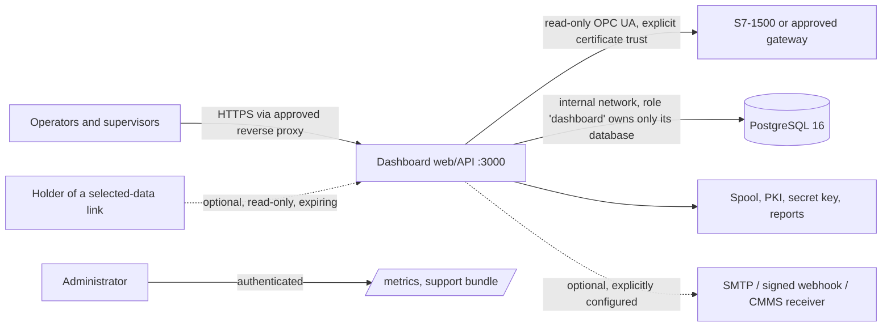

# Security and deployment boundaries

Closes TODO **F07** (access audit), **F08** (shares and embeds), **F09** (release
security review) and **D01** (OT deployment boundary) for the software, recorded
2026-10-29 in [PR #66](https://github.com/Sparkz400/performance_dashboard/pull/66). Physical-machine, customer-network and production
publisher-key acceptance remain separate. Re-run the checks below for the exact
revision and image you deploy; this record does not certify a different build.

## Access matrix (F07)

Every `/api/v1` route except sign-in and selected-data links passes `requireAuth`,
`requireMutationAccess` and the deny-by-default `authorizeAssetRequest` allowlist.
tRPC procedures map onto the same allowlist; mutations other than alarm
acknowledgement are administrator-only. Socket clients join only
`access:admin` or `access:machine:<id>` rooms derived from their signed session.

| Check | Where |
| --- | --- |
| Parses all 47 routers mounted in `server/app.ts` (244 policy routes, plus 13 sign-in and link routes) and evaluates each for viewer, wallboard, operator and supervisor with a granted, a foreign and no identifier | `server/src/__tests__/unit/accessMatrix.test.ts` |
| Reviewed per-role allow-list, frozen as a snapshot; any policy change fails until reviewed | `__snapshots__/accessMatrix.test.ts.snap` |
| Foreign identifiers reach only five scoped list routes and eight supervisor routes whose handlers check every referenced machine | same test; real-database proof in `scripts/test-access.mjs` and `scripts/test-supervisor-workflows.mjs` |
| Viewer and wallboard accounts have no write route | same test |
| All tRPC procedures: foreign identifiers refused; granted reads and operator acknowledgement only | same test |
| Anonymous requests refused on every inventoried route, tRPC and `/metrics` | `server/src/__tests__/integration/anonymous.test.ts` |
| No server code broadcasts to every socket | `accessMatrix.test.ts` |

An independent read of every allowed handler, tRPC procedure and socket event found
and closed:

- **Alarm events reached every signed-in socket.** `alertTriggered`, `alertUpdated`,
  `alertAcknowledged` and `alarmUpdated` used `io.emit`, so an account without grants
  received every machine's alarms. The three unused `alert*` events are removed and
  `alarmUpdated` uses the machine rooms. Regression: `test-access.mjs`.
- **Live-value room names could collide.** Machine data was also sent to a key-only
  room, so a key on machine B named `<A>-Count` reached a client allowed to join
  `opcua-<A>-Count`. Key-only rooms now carry only legacy unscoped data.
- **Owner list for accounts without machines.** It returned administrator usernames to
  any account. Accounts without a machine now receive an empty list.
- The OEE manual-entry read was unreachable for granted users (`/manual` vs
  `/manual-entries`); the allowlist now matches the route.

Background work (alarm evaluation, report jobs, webhook delivery, retention, health
incidents) runs without an account scope. It delivers only to administrator-configured
destinations (webhooks, SMTP recipients) and never to an account directly; anything
pushed to signed-in browsers goes through machine rooms. Two-site evidence covers
history, live rooms, exports, alarm history and alarm rules on REST and tRPC, and
immediate revocation (`scripts/test-access.mjs`).

Single-company limits: site/asset grants isolate machines inside one installation.
They are not tenant isolation; separate companies need separate installations.
Dashboard visibility follows each dashboard's declared asset list; keep it in step with
its widgets, because widget settings of an undeclared machine would be visible (its
data is still refused).

## Selected-data links (F08)

Administrators share chosen trend widgets of a dashboard from **Share Dashboard**.

- **Selection is frozen.** A link stores each widget's machine and signal keys at
  creation. Later dashboard edits cannot widen it. Only trend widgets with one machine
  and 1–32 signals can be shared; other widget types, settings, machine identifiers,
  endpoints and node identifiers are never returned.
- **Bounded data.** Each request returns only the last 1–168 hours chosen at creation,
  through the normal quality-aware trend contract (gaps and bad quality stay visible).
- **Lifetime.** Expiry is required (at most 30 days). Every request re-checks expiry,
  revocation, the dashboard and that the creator is still an active administrator.
  Revocation takes effect on the next request; the page refreshes every 15 seconds
  and clears shown data when the link stops working. Links never use sockets.
- **Tokens.** 256-bit random, shown once, stored only as SHA-256. Old plaintext tokens
  from the retired design remain unusable and are listed as *legacy* for revocation.
- **Embedding.** `/embed/<token>` may be framed only by up to five exact origins listed
  on that link (`frame-ancestors`); otherwise `frame-ancestors 'none'`. Wildcards,
  paths and non-HTTP schemes are refused. Responses are `no-store` and `no-referrer`.
- **Audit.** Creation and revocation are written to the audit log.

Evidence: `server/src/__tests__/unit/shareService.test.ts`, `scripts/test-shares.mjs`
(real database, anonymous 390-pixel browser, revocation in an open page, expiry,
creator demotion, administrator dialog). A link is a bearer capability: anyone holding
it sees the selected signals until it expires or is revoked.

## Release security review (F09)

Exact revision `04383caed80f694c308a889414de8fd66bbf1a74` (current `main`):

| Source | Result |
| --- | --- |
| CodeQL (GitHub code scanning, 2026-10-28) | 0 open alerts; 1 dismissed false positive (`js/missing-token-validation`, csrf-sync not modelled; covered by `e2e/security.spec.ts`) |
| Trivy 0.76.1, image `sha256:8c0321588c565a1c58d43bf543267d8f7416788f7bf5580c1657e7021826ea9f` (label `org.opencontainers.image.revision` = that commit) | 0 findings across 28 Wolfi and 556 Node packages; runs as `node` |
| `npm audit` (1,410 packages incl. development) | 0 advisories |
| Dependabot alerts / secret scanning / Gitleaks | 0 open / 0 open / passing |

This branch changes code after that revision; its pull request must pass the same
CodeQL, Trivy, audit and secret-scan checks on its own head before release.

Boundary checks:

| Boundary | Evidence |
| --- | --- |
| Outbound URLs (webhooks, CMMS, widget manifests) | `outboundUrlSafety.test.ts`: private/loopback/metadata addresses, credentials in URLs, DNS rebinding at connect time, redirects and >1 MiB responses refused |
| SVG (digital twins) | `sanitizeSvg.test.ts`: scripts, handlers, `foreignObject`, external `href`/`url()`, `data:` URIs, `<style>`, `<image>`, animation elements removed; sanitised again in the browser |
| Request bodies / uploads | JSON only (100 KB limit, `anonymous.test.ts` → 413); no multipart endpoints; bundles and work orders have their own row/size limits |
| CSRF and socket origin | `e2e/security.spec.ts`, integration tests with real CSRF middleware |
| Secrets | session/cookie secrets required in production; machine credentials encrypted with a separate key file (`test-secure-machine.mjs`); share tokens hashed; support bundles redacted; `.env`, keys and evidence ignored by Git and scanned by Gitleaks |

Accepted residual risks (owner: repository maintainer; revisit before each release):

- `machineScope()` returns no filter when no request scope exists, which background
  jobs rely on. Mitigation: the anonymous sweep and matrix prove every non-public
  `/api/v1` route sets a scope; public links pass explicit identifiers only.
- Webhook lists show the first 10 characters of each signing secret to administrators.
- `ALLOW_PRIVATE_OUTBOUND_URLS=true` (needed for on-premises receivers) disables the
  private-address checks; enable it only with a network policy that limits the app's
  outbound destinations.
- SMTP delivery is at least once and can duplicate after an ambiguous failure.
- Coordinated major upgrades (MUI, Storybook/Vite, lint, Vitest 5, virtualization,
  grid layout, Node 26) remain deferred; see [dependency review](DEPENDENCY_REVIEW.md).

## OT deployment boundary (D01)

| Property | How it is enforced | Verified by |
| --- | --- | --- |
| No route from the internet to a PLC is needed | The app initiates read-only OPC UA sessions; it never listens for machines | design; `test-gateway.mjs` write rejection |
| Web exposure | Published only on `127.0.0.1`; TLS terminates at the site's reverse proxy | `docker-compose.yml`, `operate.mjs`; proxy/TLS configuration is a site check |
| Database not reachable from the host | No published PostgreSQL port; preview runs on an internal network | `test-operations.mjs` |
| Least-privilege database identity | New installations create a separate `postgres` bootstrap superuser and an application role `dashboard` that is not superuser, cannot create databases/roles or replicate, and owns only `performance_dashboard`; `COPY … TO PROGRAM` is refused | `test-operations.mjs` after install and after restore |
| Least-privilege process | App container runs as UID 1000; preview proxy is read-only with all capabilities dropped | `test-container.mjs`, `operate.mjs` |
| Metrics and diagnostics | `/metrics` and support downloads require an authenticated administrator | `anonymous.test.ts` (anonymous 401), `accessMatrix.test.ts` (no non-admin route to system diagnostics) |
| Outbound traffic | Off unless configured; private targets refused by default | `outboundUrlSafety.test.ts` |
| Non-browser credentials | Service tokens (GET on the integration read endpoints only) and edge tokens (`/api/v1/edge-sync` only) are bearer secrets stored as SHA-256; their requests create no cookie session and need no CSRF token. The OIDC back-channel endpoint accepts only signed, fresh logout tokens ([identity](IDENTITY.md), [edge sites](MULTI_SITE.md)) | `test-oidc.mjs`, `test-edge-history.mjs` |

Installations made before this change keep their original database roles, where the
application role is the bootstrap superuser. To adopt the reduced role, back up and
restore into a fresh project (`operate.mjs restore`); restores always create the reduced
layout, and older dumps restore without ownership changes. Firewall rules, proxy TLS
settings and the PLC account's read-only rights must still be verified on site.
